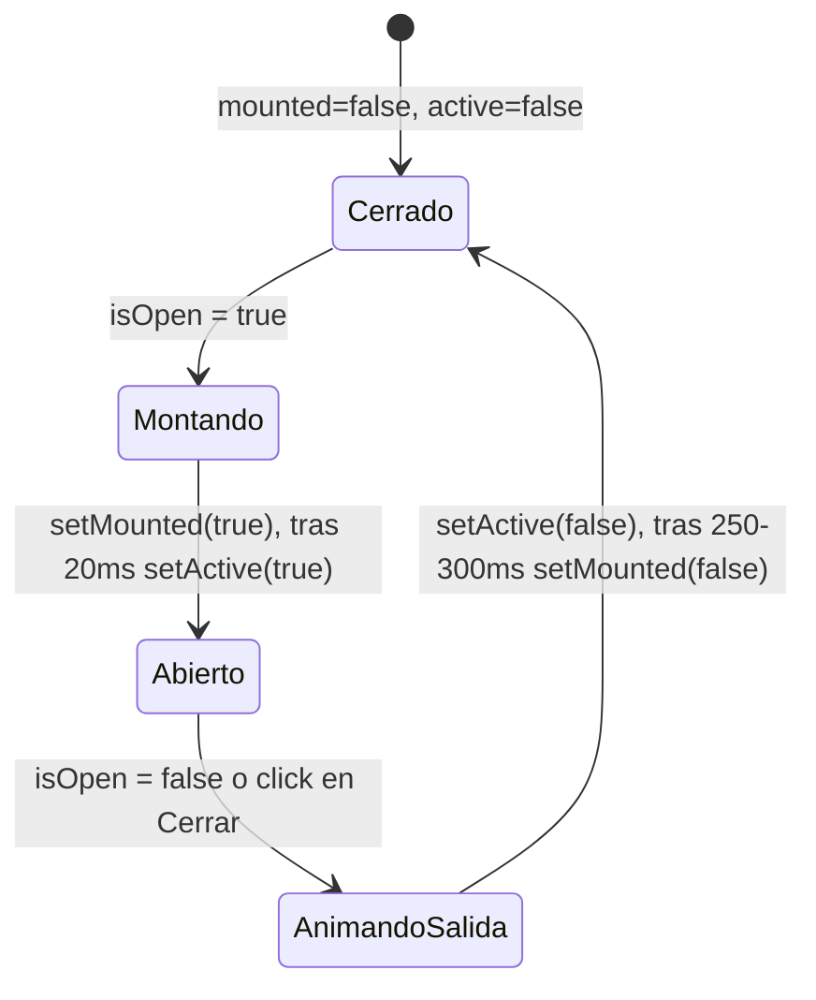

# Guía de Extracción y Replicación: Modal (Drawer, Dialog y Variante Inline con ActionSection)

Esta guía documenta la arquitectura, lógica de animación de entrada/salida y el código completo de los componentes **`Modal`** y **`ActionSection`**, listos para ser replicados en cualquier proyecto basado en **React** y **Tailwind CSS**.

---

## 1. Concepto y Arquitectura

El sistema proporciona 3 variantes de visualización unificadas bajo una misma interfaz (`<Modal ... variant="...">`):

1. **`drawer`** (Predeterminado): Panel lateral deslizante que emerge desde la derecha (`translate-x-full` → `translate-x-0`).
2. **`modal`**: Diálogo centrado con efecto de escalado y opacidad (`scale-95 opacity-0 translate-y-2` → `scale-100 opacity-100 translate-y-0`).
3. **`inline`**: **Reemplaza o cubre la sección contenedora asignada (in-place)** sin lanzar un backdrop/overlay flotante global. Se delega directamente en **`ActionSection`**, con animación sutil de desvanecimiento y traslación vertical (`opacity-0 -translate-y-2 scale-[0.99]` → `opacity-100 translate-y-0 scale-100`).

---

## 2. Mecanismo Clave de Animación (Montaje / Desmontaje Fluido)

En React tradicional, al cambiar `isOpen` a `false`, el componente se desmonta instantáneamente perdiendo la animación de salida (*exit animation*).

Tanto `Modal` como `ActionSection` resuelven esto con un patrón de doble estado **`mounted`** y **`active`**:



1. **Apertura**:
   - Se monta el elemento en el DOM (`setMounted(true)`).
   - En el siguiente ciclo de render / frame (`setTimeout(..., 20)`), se activa la clase de transición (`setActive(true)`).
2. **Cierre**:
   - Se retiran las clases de visualización (`setActive(false)`), comenzando la transición CSS de salida (`transition-all duration-300`).
   - Al cumplirse el tiempo de animación (250–300ms), se desmonta del DOM (`setMounted(false)`).
3. **Manejo de scroll y atajos**:
   - En `drawer` y `modal`, se bloquea el scroll global (`document.body.style.overflow = 'hidden'`).
   - En `inline`, el scroll global **no** se bloquea para no alterar el layout de la página contenedora.
   - Ambos escuchan la tecla **Escape (`Escape`)** para cerrar con animación fluida.

---

## 3. Dependencias Requeridas

Para replicar en un proyecto nuevo, instala Heroicons (o sustituye los iconos con tu librería preferida como Lucide):

```bash
npm install @heroicons/react
```

Asegúrate de tener configurado **Tailwind CSS**. Opcionalmente, define una clase para el botón principal (por ejemplo, en `index.css`):
```css
.btn-primary {
  @apply bg-blue-600 hover:bg-blue-700 active:bg-blue-800 text-white font-semibold transition-colors cursor-pointer;
}
```

---

## 4. Código Fuente Completo

### A. `ActionSection.jsx`
> Componente para sub-vistas in-place, formularios integrados en tarjetas y la variante `inline`.

```jsx
import { useEffect, useState } from 'react'
import { XMarkIcon, ArrowLeftIcon } from '@heroicons/react/24/outline'

/**
 * Componente ActionSection
 * Encapsula la transición fluida in-place para sub-vistas y formularios.
 * 
 * @param {boolean} isOpen - Control de visibilidad/activación
 * @param {function} onClose - Callback al cancelar o retroceder
 * @param {string|ReactNode} title - Título del panel/formulario
 * @param {string|ReactNode} subtitle - Subtítulo descriptivo opcional
 * @param {function} onConfirm - Acción al pulsar el botón principal (si no se usa form submit)
 * @param {string} confirmText - Texto del botón primario (default: 'Guardar')
 * @param {string} cancelText - Texto del botón cancelar/volver (default: 'Volver')
 * @param {boolean} isProcessing - Estado de carga del botón principal
 * @param {string} confirmButtonId - ID del form asociado a type="submit"
 * @param {boolean} showFooter - Si muestra la barra de acciones inferior
 * @param {boolean} hideConfirm - Oculta el botón de confirmar
 * @param {boolean} noPadding - Remueve el padding interno del cuerpo
 * @param {'arrow'|'x'} backIcon - 'arrow' (flecha retroceder) o 'x' (cerrar)
 * @param {ReactNode} extraHeader - Componentes extra a la derecha de la cabecera (badges, tags)
 * @param {ReactNode} children - Contenido o formulario renderizado
 */
export default function ActionSection({
  isOpen,
  onClose,
  title,
  subtitle,
  onConfirm,
  confirmText = 'Guardar',
  cancelText = 'Volver',
  isProcessing = false,
  confirmButtonId,
  showFooter = true,
  hideConfirm = false,
  noPadding = false,
  backIcon = 'arrow',
  extraHeader = null,
  children
}) {
  const [mounted, setMounted] = useState(false)
  const [active, setActive] = useState(false)

  useEffect(() => {
    let timer
    if (isOpen) {
      setMounted(true)
      timer = setTimeout(() => {
        setActive(true)
      }, 20)
    } else {
      setActive(false)
      timer = setTimeout(() => {
        setMounted(false)
      }, 250)
    }
    return () => clearTimeout(timer)
  }, [isOpen])

  const handleClose = () => {
    if (!active) return
    setActive(false)
    setTimeout(() => {
      onClose?.()
    }, 250)
  }

  // Soporte de tecla Escape para regresar con animación
  useEffect(() => {
    const handleEsc = (e) => {
      if (e.key === 'Escape' && isOpen) {
        handleClose()
      }
    }
    window.addEventListener('keydown', handleEsc)
    return () => window.removeEventListener('keydown', handleEsc)
  }, [isOpen, active])

  if (!mounted) return null

  return (
    <div
      className={`w-full bg-white dark:bg-slate-900 rounded-2xl flex flex-col transition-all duration-300 ease-in-out transform ${active
        ? 'opacity-100 translate-y-0 scale-100'
        : 'opacity-0 -translate-y-2 scale-[0.99] pointer-events-none'
        }`}
      role="region"
      aria-label={typeof title === 'string' ? title : 'Panel de acción'}
    >
      {/* Cabecera Estilizada con botón de retorno contextual */}
      <div className="flex items-start justify-between px-6 py-4 border-b border-slate-200/80 dark:border-slate-800 bg-slate-50/70 dark:bg-slate-800/40 shrink-0">
        <div className="flex items-center gap-3">
          <button
            type="button"
            onClick={handleClose}
            className="p-1.5 -ml-1 text-slate-500 hover:text-slate-800 dark:text-slate-400 dark:hover:text-slate-200 rounded-lg hover:bg-slate-200/60 dark:hover:bg-slate-700/60 transition-colors focus:outline-none focus:ring-2 focus:ring-blue-500"
            aria-label="Volver atrás"
            title="Volver atrás (Esc)"
          >
            {backIcon === 'arrow' ? (
              <ArrowLeftIcon className="h-5 w-5" />
            ) : (
              <XMarkIcon className="h-5 w-5" />
            )}
          </button>
          <div>
            <h2 className="text-base sm:text-lg font-bold text-slate-900 dark:text-white leading-tight">
              {title}
            </h2>
            {subtitle && (
              <div className="text-xs text-slate-500 dark:text-slate-400 mt-0.5 font-normal">
                {subtitle}
              </div>
            )}
          </div>
        </div>

        {extraHeader && (
          <div className="flex items-center gap-2">
            {extraHeader}
          </div>
        )}
      </div>

      {/* Cuerpo del Formulario / Vista */}
      <div className={`flex-1 ${noPadding ? '' : 'p-6'}`}>
        {children}
      </div>

      {/* Footer de Acciones */}
      {showFooter && (
        <div className="px-6 py-3.5 border-t border-slate-200/80 dark:border-slate-800 bg-slate-50/50 dark:bg-slate-800/30 flex justify-end items-center gap-3 shrink-0">
          <button
            type="button"
            onClick={handleClose}
            className="px-4 py-2 text-sm font-semibold text-white bg-red-600 hover:bg-red-700 active:bg-red-800 dark:bg-red-600/90 dark:hover:bg-red-600 rounded-lg transition-colors shadow-xs focus:outline-none focus:ring-2 focus:ring-red-500 focus:ring-offset-1 dark:focus:ring-offset-slate-900 cursor-pointer"
          >
            {cancelText}
          </button>
          {!hideConfirm && (
            <button
              type={confirmButtonId ? "submit" : "button"}
              form={confirmButtonId}
              onClick={!confirmButtonId && onConfirm ? onConfirm : undefined}
              disabled={isProcessing}
              className="btn-primary px-5 py-2 text-sm rounded-lg shadow-sm disabled:opacity-50 disabled:cursor-not-allowed focus:outline-none focus:ring-2 focus:ring-blue-500 focus:ring-offset-2 dark:focus:ring-offset-slate-900"
            >
              {isProcessing ? 'Procesando...' : confirmText}
            </button>
          )}
        </div>
      )}
    </div>
  )
}
```

---

### B. `Modal.jsx`
> Componente orquestador con soporte para `drawer`, `modal` y delegación a `inline` (`ActionSection`).

```jsx
import { useEffect, useState } from 'react'
import { XMarkIcon } from '@heroicons/react/24/outline'
import ActionSection from './ActionSection.jsx'

const sizeMapDrawer = {
  sm: 'max-w-md',
  md: 'max-w-lg',
  lg: 'max-w-xl',
  xl: 'max-w-2xl',
  '2xl': 'max-w-3xl',
  '3xl': 'max-w-4xl',
  '4xl': 'max-w-5xl',
  '5xl': 'max-w-6xl',
  '6xl': 'max-w-7xl',
  '7xl': 'max-w-[90vw]',
  full: 'max-w-[94vw]'
}

const sizeMapModal = {
  sm: 'max-w-sm',
  md: 'max-w-md',
  lg: 'max-w-lg',
  xl: 'max-w-2xl',
  '2xl': 'max-w-4xl',
  '3xl': 'max-w-5xl',
  '4xl': 'max-w-6xl',
  '5xl': 'max-w-7xl',
  '6xl': 'max-w-[92vw]',
  '7xl': 'max-w-[96vw]',
  full: 'max-w-[98vw]'
}

export default function Modal({
  isOpen,
  onClose,
  title,
  subtitle,
  onConfirm,
  confirmText = 'Guardar',
  cancelText = 'Cancelar',
  isProcessing = false,
  maxWidth,
  size,
  variant = 'drawer', // 'drawer' | 'modal' | 'inline'
  children,
  confirmButtonId,
  showFooter = true,
  hideConfirm = false,
  noPadding = false,
  backIcon = 'arrow',
  extraHeader = null
}) {
  const [mounted, setMounted] = useState(false)
  const [active, setActive] = useState(false)

  const isInline = variant === 'inline'
  const isDrawer = variant === 'drawer'

  useEffect(() => {
    let timer
    if (isOpen) {
      setMounted(true)
      timer = setTimeout(() => {
        setActive(true)
      }, 20)
      if (!isInline) {
        document.body.style.overflow = 'hidden'
      }
    } else {
      setActive(false)
      timer = setTimeout(() => {
        setMounted(false)
      }, 300)
      if (!isInline) {
        document.body.style.overflow = 'unset'
      }
    }
    return () => {
      clearTimeout(timer)
      if (!isInline) {
        document.body.style.overflow = 'unset'
      }
    }
  }, [isOpen, isInline])

  useEffect(() => {
    const handleEsc = (e) => {
      if (e.key === 'Escape' && isOpen) onClose()
    }
    window.addEventListener('keydown', handleEsc)
    return () => window.removeEventListener('keydown', handleEsc)
  }, [isOpen, onClose])

  if (!mounted) return null

  // VARIANTE INLINE: Renderiza directamente ActionSection
  if (variant === 'inline') {
    return (
      <ActionSection
        isOpen={isOpen}
        onClose={onClose}
        title={title}
        subtitle={subtitle}
        onConfirm={onConfirm}
        confirmText={confirmText}
        cancelText={cancelText}
        isProcessing={isProcessing}
        confirmButtonId={confirmButtonId}
        showFooter={showFooter}
        hideConfirm={hideConfirm}
        noPadding={noPadding}
        backIcon={backIcon}
        extraHeader={extraHeader}
      >
        {children}
      </ActionSection>
    )
  }

  const resolvedMaxWidth =
    maxWidth ||
    (size && (isDrawer ? sizeMapDrawer[size] : sizeMapModal[size])) ||
    (isDrawer ? 'max-w-2xl' : 'max-w-lg')

  // VARIANTES DRAWER / MODAL (Con backdrop fixed)
  return (
    <div
      className={`fixed inset-0 z-[100] transition-colors duration-300 ${
        isDrawer
          ? 'overflow-hidden flex justify-end bg-slate-900/30 dark:bg-black/40 backdrop-blur-[2px]'
          : 'flex items-center justify-center p-4 bg-black/50 backdrop-blur-xs'
      } ${active ? 'opacity-100' : 'opacity-0 pointer-events-none'}`}
      onClick={(e) => {
        if (e.target === e.currentTarget) onClose()
      }}
    >
      <div
        className={
          isDrawer
            ? `bg-slate-50 dark:bg-slate-900 h-full w-full ${resolvedMaxWidth} shadow-2xl flex flex-col border-l border-slate-200/80 dark:border-slate-800 transform transition-all duration-300 ease-out ${
                active ? 'translate-x-0' : 'translate-x-full'
              }`
            : `bg-slate-50 dark:bg-slate-900 rounded-2xl shadow-2xl w-full ${resolvedMaxWidth} overflow-hidden flex flex-col max-h-[90vh] transform transition-all duration-300 ease-out ${
                active
                  ? 'opacity-100 scale-100 translate-y-0'
                  : 'opacity-0 scale-95 translate-y-2'
              }`
        }
        role="dialog"
        aria-modal="true"
        onClick={(e) => e.stopPropagation()}
      >
        {/* Cabecera */}
        <div className="flex items-start justify-between px-6 py-4.5 border-b border-slate-200/80 dark:border-slate-800 bg-white/95 dark:bg-slate-900/95 backdrop-blur-sm shrink-0">
          <div>
            <h2 className="text-lg font-bold text-slate-800 dark:text-white leading-tight">
              {title}
            </h2>
            {subtitle && (
              <div className="text-xs text-slate-500 dark:text-slate-400 mt-1 font-normal">
                {subtitle}
              </div>
            )}
          </div>
          <button
            type="button"
            onClick={onClose}
            className="p-1.5 -mr-1 -mt-1 text-slate-400 hover:text-slate-600 dark:hover:text-slate-300 rounded-lg hover:bg-slate-100 dark:hover:bg-slate-800 transition-colors focus:outline-none focus:ring-2 focus:ring-blue-500"
            aria-label="Cerrar panel"
          >
            <XMarkIcon className="h-5 w-5" />
          </button>
        </div>

        {/* Cuerpo */}
        <div className={`overflow-y-auto flex-1 dark:bg-slate-900/50 ${noPadding ? '' : 'p-6'}`}>
          {children}
        </div>

        {/* Footer */}
        {showFooter && (
          <div className="px-6 py-3.5 border-t border-slate-200/80 dark:border-slate-800 bg-white/95 dark:bg-slate-900/95 backdrop-blur-sm flex justify-end items-center gap-3 shrink-0">
            <button
              type="button"
              onClick={onClose}
              className="px-4 py-2 text-sm font-semibold text-white bg-red-600 hover:bg-red-700 active:bg-red-800 dark:bg-red-600/90 dark:hover:bg-red-600 rounded-lg transition-colors shadow-xs focus:outline-none focus:ring-2 focus:ring-red-500 focus:ring-offset-1 dark:focus:ring-offset-slate-900 cursor-pointer"
            >
              {cancelText}
            </button>
            {!hideConfirm && (
              <button
                type={confirmButtonId ? 'submit' : 'button'}
                form={confirmButtonId}
                onClick={!confirmButtonId && onConfirm ? onConfirm : undefined}
                disabled={isProcessing}
                className="btn-primary px-5 py-2 text-sm rounded-lg shadow-sm disabled:opacity-50 disabled:cursor-not-allowed focus:outline-none focus:ring-2 focus:ring-blue-500 focus:ring-offset-2 dark:focus:ring-offset-slate-900"
              >
                {isProcessing ? 'Procesando...' : confirmText}
              </button>
            )}
          </div>
        )}
      </div>
    </div>
  )
}
```

---

## 5. Ejemplos de Uso

### Ejemplo 1: Reemplazar una tabla/lista con el formulario inline (`variant="inline"`)
```jsx
import { useState } from 'react'
import Modal from './Modal'

export default function ClientsPage() {
  const [showCreate, setShowCreate] = useState(false)

  return (
    <div className="p-6">
      {!showCreate ? (
        <div>
          <button 
            onClick={() => setShowCreate(true)}
            className="btn-primary px-4 py-2 rounded-lg mb-4"
          >
            Nuevo Cliente
          </button>
          <div className="bg-white p-6 rounded-xl shadow-xs">
            Tabla de clientes...
          </div>
        </div>
      ) : (
        <Modal
          variant="inline"
          isOpen={showCreate}
          onClose={() => setShowCreate(false)}
          title="Crear Nuevo Cliente"
          subtitle="Completa los datos del cliente corporativo"
          onConfirm={() => {
            alert('Guardado')
            setShowCreate(false)
          }}
        >
          <form className="space-y-4">
            <div>
              <label className="block text-sm font-medium mb-1">Nombre</label>
              <input type="text" className="w-full border rounded-lg p-2" />
            </div>
          </form>
        </Modal>
      )}
    </div>
  )
}
```

### Ejemplo 2: Usar `ActionSection` directamente como contenedor
```jsx
import ActionSection from './ActionSection'

<ActionSection
  isOpen={isEditing}
  onClose={() => setIsEditing(false)}
  title="Editar Parámetros"
  backIcon="arrow"
  extraHeader={<span className="badge badge-info">Borrador</span>}
  onConfirm={handleSave}
>
  <p>Formulario de configuración...</p>
</ActionSection>
```
